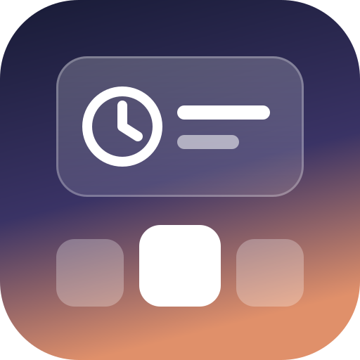
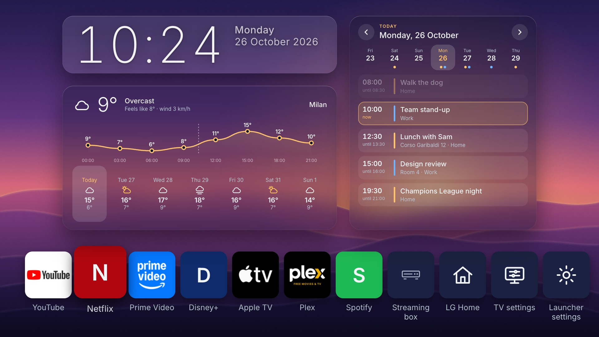
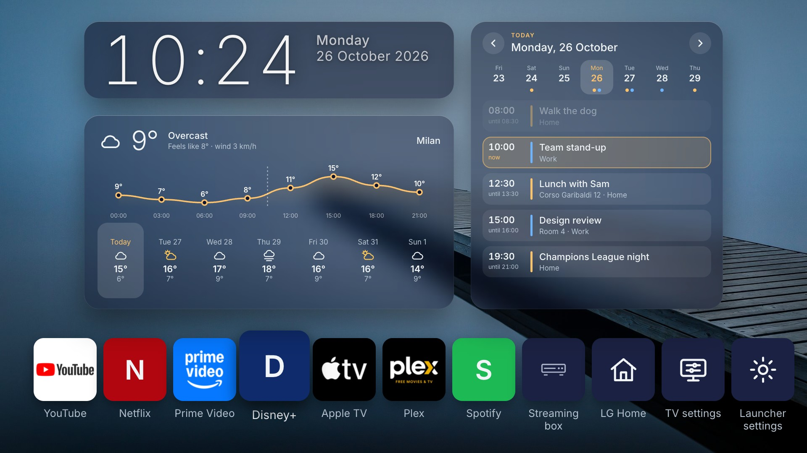
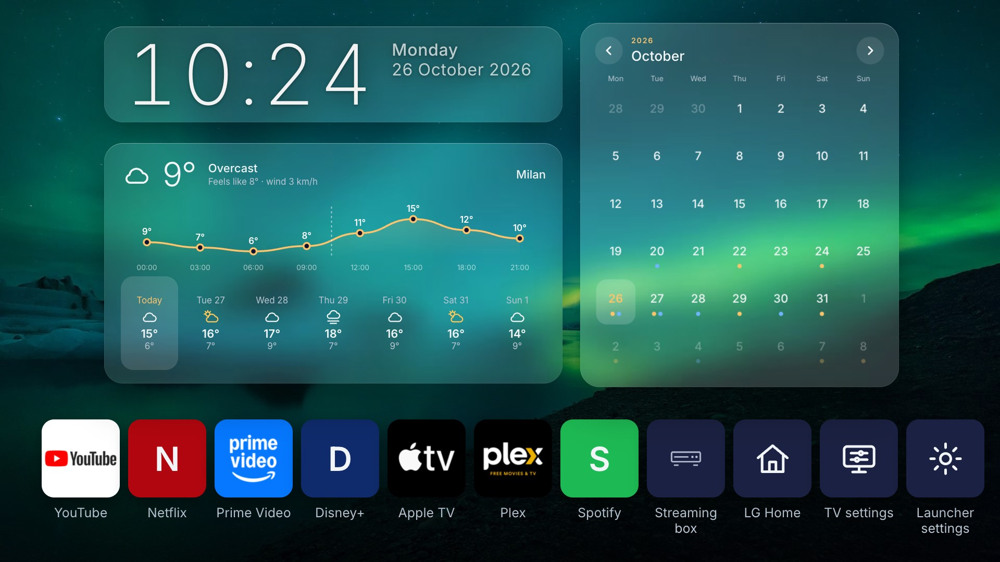
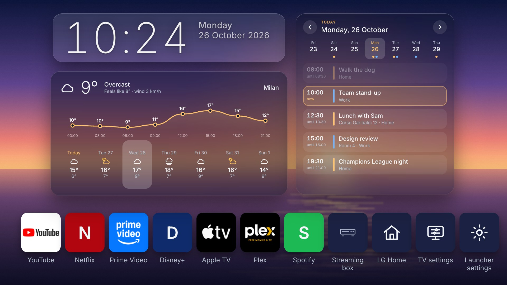
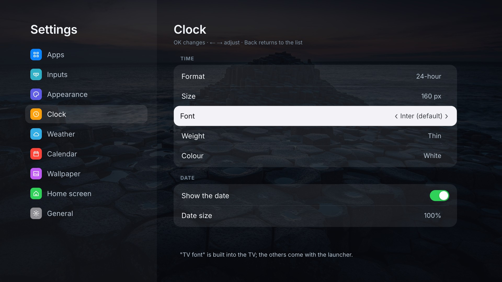

<p align="center"></p>

# Simple LG launcher

A quieter home screen for LG webOS TVs. You get a clock, the weather, your day from Google Calendar and one row of apps, laid over a wallpaper of your own. No ads, no rows of recommendations, nothing that autoplays.

It started as a fork of [Hearth](https://github.com/rudra-avatar/Hearth) by rudra-avatar. Hearth already had the hard parts working: the app row, the clock, the settings screens and the plumbing through the Homebrew Channel. This fork adds the calendar, the frosted-glass cards, a seven-day forecast with an hourly curve, a language switch (thirteen languages) and ways to make the launcher the TV's Home, so the Home button opens it.

> **The easy way to install it:** give the link to this repository to Claude Code or Codex and ask it to set the launcher up on your TV. [AGENTS.md](AGENTS.md) walks the agent through every step: building, installing, making it the home screen and adding your calendars. It checks with you before it changes anything on the TV. You only need a rooted TV and its IP address.



| | |
|---|---|
|  |  |
|  |  |

## What's on the screen

- **Clock and date.** A large clock with the weekday and date next to it. Six typefaces, three weights, any size, 12- or 24-hour.
- **Weather** from [Open-Meteo](https://open-meteo.com), no account needed. You see the temperature now, what it feels like, the wind, an hourly curve for the day and seven days ahead. The card is not just a picture: press ↑ from the app row to step onto it, then ← → scroll through the days, and the curve redraws for each one. With the Magic Remote you can click a day instead.
- **Calendar.** Paste the secret iCal address of a Google Calendar (or any `.ics` link). You can add several, and each gets its own colour. Repeating events, exceptions, moved events and all-day events all work. Like the weather, it reacts to the remote: step onto it, ← → scroll back and forth through the days, ↑ opens the whole month with a dot under each busy day. The Magic Remote pointer can click through it too.
- **Frosted glass.** The cards blur the wallpaper behind them, as much as you like (30 to 100%). The cards go light or dark together, depending on how bright the picture behind them is, so the text stays readable on any photo; when the wallpaper changes, the glass and the card colour fade with it.
- **Your apps in one row.** Hold OK on a tile to move it, hide it or uninstall the app. The selected tile grows a little; that's all the animation there is. App names under every tile, only under the selected one, or none.
- **Wallpaper.** One picture or a slideshow of a folder, from a USB stick or the TV's own storage, with shuffle and an interval from 10 seconds to an hour. The TV shows the same picture for the moment the launcher takes to start (or the logo, or black).
- **Pixel shift for OLED.** Everything moves a few whole pixels once a minute, so nothing stays on the same pixels for hours. On by itself when the TV's model name says OLED.
- **Sharp text.** The TV draws apps at 1080p and scales them up to 4K, so text on half pixels comes out soft. The launcher keeps its text on whole pixels.
- **Thirteen languages.** English, Russian, Spanish, French, German, Italian, Portuguese, Turkish, Ukrainian, Polish, Chinese (Simplified), Japanese and Korean. Thanks to [DriftEngineer](https://github.com/DriftEngineer) for the Polish translation! It follows the TV's language by default (English when the TV speaks another one). Settings → Home screen → Language changes it. The Chinese, Japanese and Korean texts are drawn with the TV's own font.

## What you need

- An LG TV with webOS, **rooted** with the [Homebrew Channel](https://www.webosbrew.org/), with SSH turned on in the Homebrew Channel's settings. Rooting depends on the model and firmware; webosbrew.org keeps track of what works where.
- A computer on the same network, with Node.js 18 or newer and `ssh`.

I use it every day on an LG 43QNED84A6C (2025, webOS 25, internal release 10.3). Hearth itself has been run on webOS 4 through 8. The app should work on those too. Making it the home screen (below) has only been tried on webOS 25.

Without root the launcher still opens like any other app, and the clock and weather work. It can't read the full app list, your USB pictures or a Google calendar link (the TV fetches those through the Homebrew Channel), and it can't replace LG Home. Those settings are greyed out with the reason.

## Installing it yourself

```bash
git clone https://github.com/fardroid/Simple-LG-launcher.git
cd Simple-LG-launcher
npm ci
npm run build && npm run package          # makes build/tld.my.simplelauncher_<version>_all.ipk
TV_HOST=root@<tv-ip> npm run install:tv   # copies it over SSH, installs and opens it
```

You can put `TV_HOST=root@<tv-ip>` in a `tv.env` file (copy `tv.env.example`) so you don't have to type it each time. If you don't want to use SSH, [webOS Dev Manager](https://github.com/webosbrew/dev-manager-desktop) can install the `.ipk` too.

**Updating.** The same commands. The TV keeps the launcher loaded in memory (in the Swap way below, a second copy too, the one behind the Home button), and a copy left loaded keeps showing the old version. `npm run install:tv` closes them, and from 1.9.2 on a copy that was missed reloads itself the next time it goes to the background. No need to restart the TV.

## Making it the home screen

On the TV: Settings → Home screen → **How the launcher opens**. It lists four ways, each with how it works and its pros and cons; OK twice switches. The way that was on is switched off first, and if the new one does not take, the old one comes back.

**1. Official** (the one I use on webOS 25). webOS lets you choose which app is Home, the way a computer lets you choose its browser: the launcher declares itself a Home app (`appCategory: ["home"]`) and is chosen with the TV's own `setDefaultApp`. The Home button and Back out of the last app then open the launcher. Waking from standby does not ask for the Home app: the TV opens LG Home by name when its *start with Home* setting is on, and otherwise its last input. So this way switches *start with Home* off and names the launcher as the last input (the trick of [openhome-webos](https://github.com/devic021/openhome-webos)); opening an HDMI input names that input again, so the launcher names itself once more whenever it comes to the front or goes to the back. The three settings are put back when you switch this way off. And when the TV goes to standby its app manager closes every app but a short list (LG Home is on it), so the launcher would start from scratch after waking; this way adds it to that list (`keepAliveApps`, a copy of the TV's config file mounted over it in RAM at every start, then the app manager restarted), and it is back about a second after waking. Nothing of LG's is replaced or mounted, it lasts across a full restart, and LG Home stays on its own tile. Only on TVs that offer the choice (webOS 25 and newer). If you uninstall the launcher while this is on, the Home button opens nothing until a full restart, after which LG Home is back by itself; switch to *Off* first. The method is from [Lumen](https://github.com/ammar027/lumen-webos). From a computer: [tools/defaulthome.sh](tools/defaulthome.sh) `enable | disable | status`.

**2. Swap** ([tools/takeover.sh](tools/takeover.sh)). For TVs that can't choose a Home app. A small folder is bind-mounted over LG Home's app folder: in it are links to the launcher's files and an `appinfo.json` with LG Home's ID, so the TV opens the launcher thinking it is LG Home. Nothing on the read-only system is changed (it all lives in memory), and *Off* undoes it. Things to know:

- After a full restart of the TV (not standby), LG Home shows for about 40 seconds, until the Homebrew Channel's start-up scripts put the launcher back.
- The launcher needs the Homebrew Channel's root service, and LG Home's permissions don't include it. The script mounts a copy of that permissions file with the service added. In plain words: whatever runs as Home can run commands as root, which the launcher could already do as itself.
- The method comes from [Glasshouse](https://github.com/rorygallagher2024/glasshouse) and [Luma](https://github.com/ecklf/lg-luma).

**3. Helper.** A small script on the TV watches for LG Home and opens the launcher over it, from the moment the TV starts. Nothing is mounted or replaced, but LG Home can flash for a moment, and the script keeps running.

**4. Off.** The launcher is an ordinary app with its own tile; Home opens LG Home.

The scripts behind them ship with the app (`tools/` in its folder): `sh tools/homemode.sh status` and `set none | default | mount` do the same from SSH.

**Optional: a lighter TV** ([tools/tv-tweaks.sh](tools/tv-tweaks.sh)). It stops LG Channels and the browser from preloading, which leaves more memory free so the TV unloads the launcher less often. It also turns off LG's promotions, sports alerts, recommendations and Live Plus (the TV recognising what is on screen). It saves the old values first, so `restore` undoes everything. Run it the same way: `sh tv-tweaks.sh apply | restore | status`. The ideas are from [webos-debloat](https://gist.github.com/lucataco/7c303b443934008a9031a55cfca552ec) by lucataco.

## Calendars

In Google Calendar on a computer, open Settings, choose the calendar, and copy **Secret address in iCal format**. Then on the TV, open Settings → Widgets → Calendars → *Add a link*.

Typing a long link with the remote is no fun. You can put the links in a file on the TV instead, one per line, and choose *Read the list from a file*:

```bash
ssh root@<tv-ip> 'cat > /media/developer/calendar.txt' < my-calendars.txt
```

A folder of `.ics` files (`/media/developer/cals/`) works as well.

On the home screen, press ↑ until the calendar is selected: ← → move through the days, and ↑ once more opens the month view. OK jumps back to today. With the Magic Remote you can simply point and click: the arrows on the card or a day in the strip.

The secret address gives read access to that calendar to anyone who has it. It is only stored on the TV and only sent to Google. Don't commit it anywhere.

## Wallpapers

Settings → Wallpaper → Picture opens a folder browser for USB drives and the TV's storage (`/media/developer`). OK on a picture sets it, and *Play this folder as a slideshow* plays the whole folder. JPG or PNG at 1920×1080 to 3840×2160 work best. Anything over 8 MB or 25 megapixels is skipped, with a message.

The [`wallpapers`](wallpapers) folder has thirteen to start with: soft gradients, dunes, auroras and a sea at dawn, all drawn for this launcher and free to use. To put them on the TV:

```bash
ssh root@<tv-ip> mkdir -p /media/developer/wallpapers
scp -O wallpapers/*.jpg root@<tv-ip>:/media/developer/wallpapers/
```

## Privacy

For the weather the launcher sends the coordinates of your city to Open-Meteo, plus whatever you type into the city search. The calendar links are fetched by the TV directly. Nothing else leaves the TV, and there is no tracking of any kind.

## Working on it

```bash
npm run dev    # the launcher in a desktop browser at 1920x1080, with sample apps
npm test
```

The code is TypeScript and [Preact](https://preactjs.com), built for Chrome 53 so it runs on older web views too. [CHANGELOG.md](CHANGELOG.md) has the history, Hearth's versions included.

## Credits

- [Hearth](https://github.com/rudra-avatar/Hearth) by rudra-avatar, which this is a fork of (and the idea for the pixel shift). If you'd rather have the original (more fonts, a recent apps panel, a quiet mode, no calendar), go there.
- [partridgeworks/webos-launcher](https://github.com/partridgeworks/webos-launcher), which Hearth itself grew out of.
- [Lumen](https://github.com/ammar027/lumen-webos), for the official way to be the TV's Home app, and [openhome-webos](https://github.com/devic021/openhome-webos), for waking up into it.
- [Glasshouse](https://github.com/rorygallagher2024/glasshouse) and [Luma](https://github.com/ecklf/lg-luma), for the way to take LG Home's place, and Luma for the start-up picture.
- [webos-debloat](https://gist.github.com/lucataco/7c303b443934008a9031a55cfca552ec) by lucataco, for the TV tweaks.
- [Open-Meteo](https://open-meteo.com) for the free weather, and the [webOS Homebrew](https://www.webosbrew.org/) project, without which none of this would run.

Fonts and other bundled material are listed in [THIRD_PARTY_NOTICES.md](THIRD_PARTY_NOTICES.md). MIT licence, see [LICENSE](LICENSE). Not affiliated with LG Electronics; "LG" and "webOS" are their trademarks.
