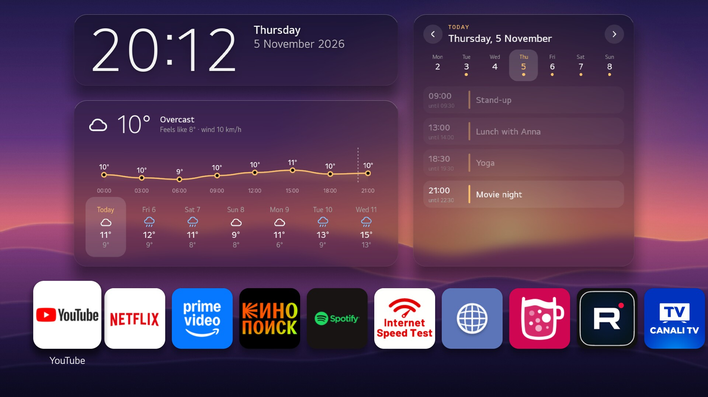
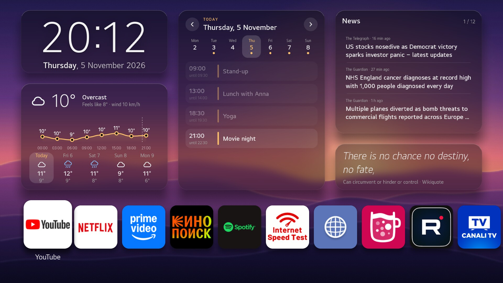
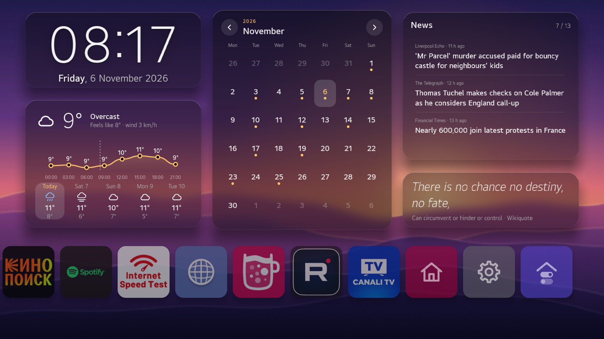
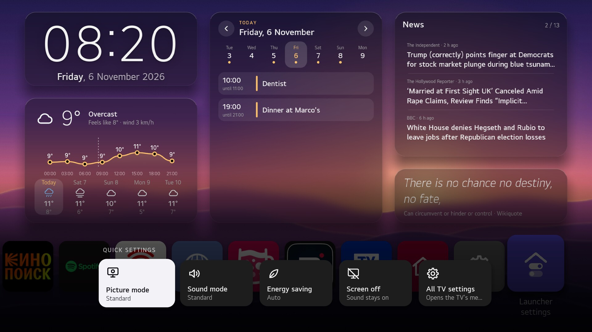
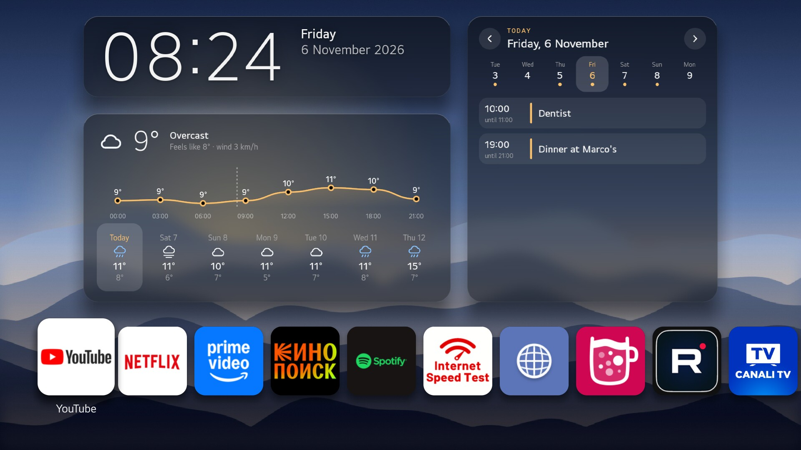
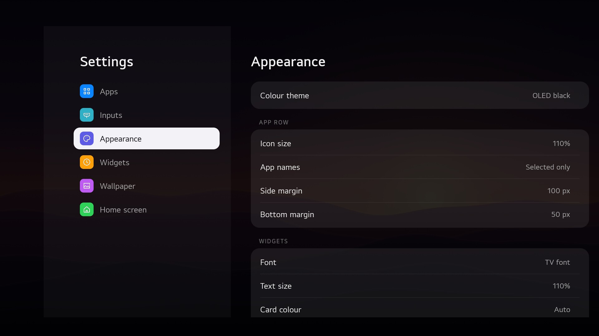
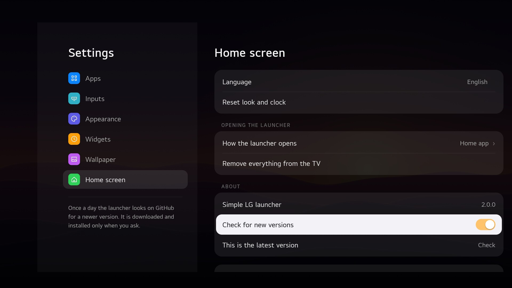
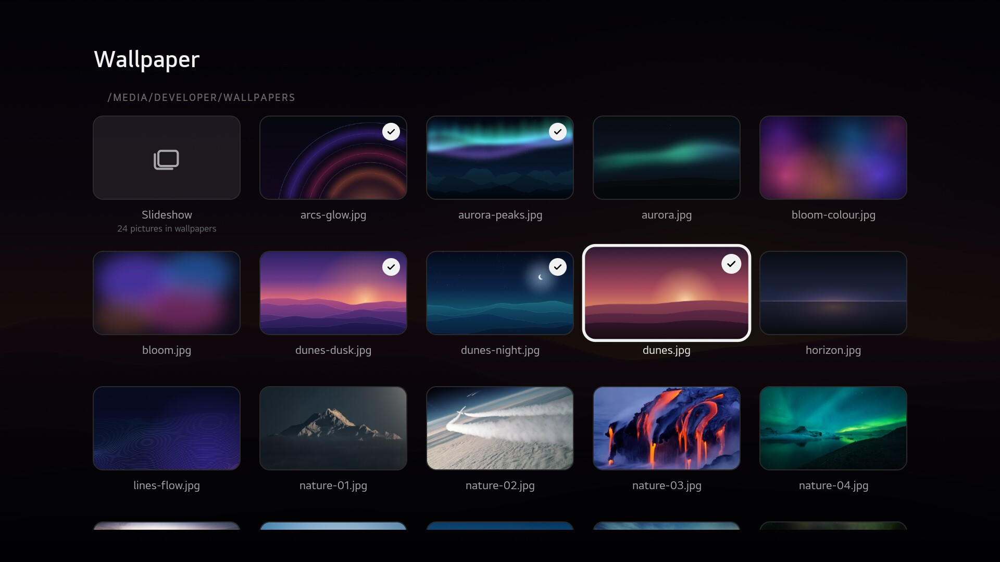
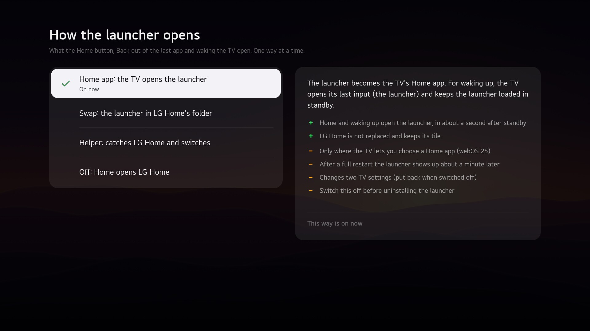

<p align="center"></p>

# Simple LG launcher (native)

A native quieter home screen for LG webOS TVs. You get a clock, the weather, your day from Google Calendar, the news and one row of apps, laid over a wallpaper of your own. No ads, no rows of recommendations, nothing that autoplays.

Smooth and fast, with no lag: scrolling the row, stepping between the cards and opening Settings run at the full frame rate the TV gives any app (48 a second on my 43QNED84). The launcher was rewritten from a web page into C++ with SDL and OpenGL ES, drawn straight on the TV's graphics plane, and it fetches the weather, calendars and news itself, without going through the Homebrew Channel.

It began as a fork of [Hearth](https://github.com/rudra-avatar/Hearth) by rudra-avatar. This version adds the calendar, the news, frosted-glass cards, a seven-day forecast, thirteen languages and ways to make the launcher the TV's Home.



| | |
|---|---|
|  |  |
|  |  |
|  |  |
|  |  |

## The easy way to install it

Give the link to this repository to Claude Code or Codex and ask it to set the launcher up on your TV. [AGENTS.md](AGENTS.md) walks the agent through every step: installing, making it the home screen and adding your calendars. It checks with you before it changes anything on the TV. You only need a rooted TV and its IP address.

## What's on the screen

- **Clock and date.** A large clock with the weekday and date. Six typefaces, five weights, any size, 12- or 24-hour.
- **Weather** from [Open-Meteo](https://open-meteo.com), no account needed. You see the temperature now, what it feels like, the wind, an hourly curve for the day and seven days ahead. Press ↑ from the app row to step onto the card, then ← → move through the days and the curve redraws for each one. With the Magic Remote you can click a day instead.
- **Calendar.** Paste the secret iCal address of a Google Calendar (or any `.ics` link). You can add several, and each gets its own colour. Repeating events, exceptions, moved events and all-day events all work. Step onto it, ← → move through the days, ↑ opens the whole month with a dot under each busy day. The Magic Remote pointer can click through it too.
- **News.** Headlines from Google News for the country you choose, in the launcher's language when that country has an edition in it, and from any RSS or Atom feeds you add. Step onto the card: ↑ ↓ choose a headline, ← → turn the pages, and OK shows the headline with its description and a QR code, so you can read the article on your phone. While you are elsewhere the pages turn by themselves.
- **Quote of the day** from Wikiquote, in the launcher's language. Where the language's Wikiquote has an editors' quote of the day, you get that one. Elsewhere, or on a day the editors left empty, a quote is picked by the date from the page of a well-known writer, poet, thinker or scientist.
- **Frosted glass.** The cards blur the wallpaper behind them, as much as you like (30 to 100%). They go light or dark together, depending on how bright the picture behind them is, so the text stays readable on any photo. When the wallpaper changes, the glass fades with it.
- **Quick settings.** Press ↓ from the app row: picture mode, sound mode, energy saving, screen off and the TV's full settings, without leaving the home screen.
- **Wallpaper.** One picture or a slideshow, from a USB stick or the TV's own storage, with shuffle and an interval from 10 seconds to an hour.
- **Pixel shift for OLED.** Everything moves a few pixels once a minute, so nothing stays on the same pixels for hours. On by itself when the TV's model name says OLED.
- **Thirteen languages.** English, Russian, Spanish, French, German, Italian, Portuguese, Turkish, Ukrainian, Polish, Chinese (Simplified), Japanese and Korean. The translations are machine-made by an LLM, so some phrases may sound unnatural; corrections are welcome. Polish started from [DriftEngineer](https://github.com/DriftEngineer)'s translation, thank you! The launcher follows the TV's language by default (English when the TV speaks another one); Settings → Home screen → Language changes it.

## What you need

- An LG TV with webOS, **rooted** with the [Homebrew Channel](https://www.webosbrew.org/). Rooting depends on the model and firmware; webosbrew.org keeps track of what works where.
- For installing over SSH (optional): SSH turned on in the Homebrew Channel's settings, and a computer on the same network.
I use it every day on an LG 43QNED84A6C (2025, webOS 25, internal release 10.3). Making it the home screen has only been tried on webOS 25.

I have only tried it on a rooted TV. What needs root is greyed out in Settings, with the reason.

## Installing it

Download `tld.my.simplelauncher_<version>_arm.ipk` from [Releases](https://github.com/fardroid/Simple-LG-launcher/releases) for A) and C).

### A) Over SSH

Needs SSH turned on in the Homebrew Channel's settings. In the commands below, replace `<tv-ip>` with your TV's address (TV Settings → Network → your connection), for example `192.168.1.50`: then `root@<tv-ip>` becomes `root@192.168.1.50`. Open a terminal in the folder where you downloaded the package and run two commands.

Copy the package to the TV:

```bash
scp -O tld.my.simplelauncher_2.1.0_arm.ipk root@<tv-ip>:/tmp/
```

Install it (one line, copy it whole):

```bash
ssh -tt root@<tv-ip> "luna-send -w 60000 -i luna://com.webos.appInstallService/dev/install '{\"id\":\"com.ares.defaultName\",\"ipkUrl\":\"/tmp/tld.my.simplelauncher_2.1.0_arm.ipk\",\"subscribe\":true}' | grep -E 'installed|errorText' | head -1"
```

When it is done it prints a long line that contains `"state":"installed"`. Then open Simple LG launcher from the TV's app list.

### B) From the Homebrew Channel

In the Homebrew Channel, open Settings and add this repository:

```
https://raw.githubusercontent.com/fardroid/Simple-LG-launcher/main/repo/apps.json
```

Simple LG launcher then shows up in the app list; install it from there.

### C) From a file

Install the `.ipk` with [webOS Dev Manager](https://github.com/webosbrew/dev-manager-desktop) or `ares-install`.

### Coming from version 1

Install 2.1.0 over it, the same way you updated before. It keeps the same app ID, so your settings, calendars, hidden apps and the way it opens on Home all carry over by themselves on its first start. Nothing to run by hand.

### Updates: once you turn it on, nothing more to install by hand

Settings → Home screen → About → **Check for new versions**. With it on, the launcher looks on GitHub once a day for a newer version. When there is one, a note appears on the home screen and an *Update* tile in the row. Press it: the launcher downloads the package, checks it against its SHA-256 checksum and installs it through the TV's own installer, then opens again in the new version. Nothing is downloaded or installed until you ask. No SSH, no `.ipk`, no computer. The row under the switch checks right away. Installing needs root (the Homebrew Channel).

### webOS 26: one command, once

This is the only thing you may have to run by hand, and only on webOS 26. There apps are no longer allowed to use the Homebrew Channel's command service by default, so even on a rooted TV the launcher gets *"Denied method call "exec" for category "/""*, and everything that needs root stays greyed out. (The Homebrew Channel tracks this in [webos-homebrew-channel#255](https://github.com/webosbrew/webos-homebrew-channel/issues/255).) Once, over SSH on the TV:

```bash
sh /media/developer/apps/usr/palm/applications/tld.my.simplelauncher/tools/webos26-access.sh install
```

It adds one permission to the launcher (the group `org.webosbrew.hbchannel.service.group`, which the Homebrew Channel's own app has) and reopens it. webOS writes that permission file again on every install or update, so the script also leaves a small watcher running (started at each boot from the Homebrew Channel's startup folder): after an update it adds the permission back by itself, so updates from Settings keep working. Settings shows the same command where it is needed. Before uninstalling the launcher, run it with `remove`. On webOS 25 and older it does nothing. The fix is from [Hearth](https://github.com/rudra-avatar/Hearth) (by ganondorft); I have no webOS 26 TV to try it on.

## Making it the home screen

On the TV: Settings → Home screen → **How the launcher opens**. It lists four ways, each with how it works and its pros and cons; OK twice switches. The way that was on is switched off first, and if the new one does not take, the old one comes back. No SSH needed.

**1. Home app** (the one I use on webOS 25). webOS lets you choose which app is Home, the way a computer lets you choose its browser: the launcher declares itself a Home app (`appCategory: ["home"]`) and is chosen with the TV's own `setDefaultApp`. The Home button and Back out of the last app then open the launcher. Waking from standby does not ask for the Home app: the TV opens LG Home by name when its *start with Home* setting is on, and otherwise its last input. So this way switches *start with Home* off and names the launcher as the last input (the trick of [openhome-webos](https://github.com/devic021/openhome-webos)). Both settings are put back when you switch this way off. When the TV goes to standby, its app manager closes every app but a short list (LG Home is on it); this way adds the launcher to that list (`keepAliveApps`, a copy of the TV's config file mounted over it in RAM at every start), so it is back about a second after waking. Nothing of LG's is replaced, and LG Home stays on its own tile. Things to know:

- Only on TVs that offer the choice (webOS 25 and newer).
- After a full restart (not standby) the TV shows no webOS logo, and the launcher settles about a minute later: the app manager has to be restarted once to take the list.
- If you uninstall the launcher while this is on, the Home button opens nothing until a full restart, after which LG Home is back by itself. Switch to *Off* first.
- The method is from [Lumen](https://github.com/ammar027/lumen-webos).

**2. Swap** (for TVs that can't choose a Home app). A small folder is mounted over LG Home's app folder: in it are links to the launcher's program and a manifest with LG Home's ID, so the TV starts the launcher thinking it is LG Home. Nothing on the read-only system is changed (it all lives in memory), and *Off* undoes it. After a full restart the TV opens the launcher straight away. The method comes from [Luma](https://github.com/ecklf/lg-luma) and [Glasshouse](https://github.com/rorygallagher2024/glasshouse).

**3. Helper.** A small script on the TV watches for LG Home and opens the launcher over it, from the moment the TV starts. Nothing is mounted or replaced, but LG Home can flash for a moment, and the script keeps running.

**4. Off.** The launcher is an ordinary app with its own tile; Home opens LG Home.

*Remove everything from the TV* under the same screen switches the way off and deletes what it left on the TV, for before you uninstall. The scripts behind these ship with the app (`tools/` in its folder); `sh tools/homemode.sh status` and `set none | default | mount` do the same from SSH.

**Optional: a lighter TV** ([tools/tv-tweaks.sh](tools/tv-tweaks.sh)). It stops LG Channels and the browser from preloading, which leaves more memory free so the TV unloads the launcher less often. It also turns off LG's promotions, sports alerts, recommendations and Live Plus (the TV recognising what is on screen). It saves the old values first, so `restore` undoes everything: `sh tv-tweaks.sh apply | restore | status`. The ideas are from [webos-debloat](https://gist.github.com/lucataco/7c303b443934008a9031a55cfca552ec) by lucataco.

## Calendars

In Google Calendar on a computer, open Settings, choose the calendar, and copy **Secret address in iCal format**. Then on the TV, open Settings → Widgets → Calendars → *Add a link*.

Typing a long link with the remote is no fun. You can put the links in a file on the TV instead, one per line, and choose *Read the list from a file*:

```bash
ssh root@<tv-ip> 'cat > /media/developer/calendar.txt' < my-calendars.txt
```

A folder of `.ics` files (`/media/developer/cals/`) works as well.

On the home screen, press ↑ until the calendar is selected: ← → move through the days, and ↑ once more opens the month view. OK jumps back to today. With the Magic Remote you can simply point and click: the arrows on the card or a day in the strip.

The secret address gives read access to that calendar to anyone who has it. It is only stored on the TV and only sent to Google. Don't commit it anywhere.

## News

Settings → Widgets → News. *Google News* shows the top stories of a country; *Country* picks it. At first it is the TV's own country when Google News has an edition there in the launcher's language, otherwise the country of that language (Germany for German, Poland for Polish and so on), so every one of the thirteen languages gets news in it. *Your feeds* takes the address of any RSS or Atom feed, typed with the on-screen keyboard (up to eight). You can turn Google News off and keep only your own feeds. The launcher fetches the feeds itself, so the news works without root too.

## Quote of the day

Settings → Widgets → Quote of the day. The quote comes from [Wikiquote](https://wikiquote.org) in the launcher's language and changes at midnight. In languages without an editors' quote of the day (Russian, German, French, Japanese), the launcher asks [Wikidata](https://www.wikidata.org) once a month for about 400 well-known authors who have a page there, then picks an author and a quote from their page by the date.

## Wallpapers

Settings → Wallpaper → Picture opens a gallery of USB drives and the TV's storage (`/media/developer`): folders and pictures as tiles, each picture with its preview. OK ticks pictures, in any folders, and leaving the gallery shows them (one picture, or a slideshow of the ticked ones); the *Slideshow* tile plays a whole folder. JPG or PNG at 1920×1080 to 3840×2160 work best. Anything over 8 MB or 25 megapixels is skipped, with a message.

The [`wallpapers`](wallpapers) folder has thirteen to start with: soft gradients, dunes, auroras and a sea at dawn, all drawn for this launcher and free to use. To put them on the TV:

```bash
ssh root@<tv-ip> mkdir -p /media/developer/wallpapers
scp -O wallpapers/*.jpg root@<tv-ip>:/media/developer/wallpapers/
```

## Privacy

For the weather the launcher sends the coordinates of your city to Open-Meteo, plus whatever you type into the city search. The calendar links and the news feeds are fetched by the TV directly (Google News learns the country and the language you chose). The quote of the day comes from Wikiquote and Wikidata, which learn only the language. With *Check for new versions* on, the TV reads a small file from GitHub once a day. Nothing else leaves the TV, and there is no tracking of any kind.

## Credits

- [Hearth](https://github.com/rudra-avatar/Hearth) by rudra-avatar, which this is a fork of (and the idea for the pixel shift). If you'd rather have the original (more fonts, a recent apps panel, a quiet mode, no calendar), go there.
- [partridgeworks/webos-launcher](https://github.com/partridgeworks/webos-launcher), which Hearth itself grew out of.
- [Lumen](https://github.com/ammar027/lumen-webos), for the official way to be the TV's Home app, and [openhome-webos](https://github.com/devic021/openhome-webos), for waking up into it.
- [Luma](https://github.com/ecklf/lg-luma) and [Glasshouse](https://github.com/rorygallagher2024/glasshouse), for the way to take LG Home's place, and Luma for the start-up picture.
- [webos-debloat](https://gist.github.com/lucataco/7c303b443934008a9031a55cfca552ec) by lucataco, for the TV tweaks.
- [SDL-webOS](https://github.com/webosbrew/SDL-webOS) and the [native toolchain](https://github.com/webosbrew/native-toolchain) by webosbrew, [nlohmann/json](https://github.com/nlohmann/json), [pugixml](https://pugixml.org) and [QR Code generator](https://www.nayuki.io/page/qr-code-generator-library) by Nayuki.
- [Open-Meteo](https://open-meteo.com) for the free weather, and the [webOS Homebrew](https://www.webosbrew.org/) project, without which none of this would run.

[CHANGELOG.md](CHANGELOG.md) has the history, the web version's (the last one is tagged `v1.10.1`) and Hearth's included. Fonts and other bundled material are listed in [THIRD_PARTY_NOTICES.md](THIRD_PARTY_NOTICES.md). MIT licence, see [LICENSE](LICENSE). Not affiliated with LG Electronics; "LG" and "webOS" are their trademarks.
